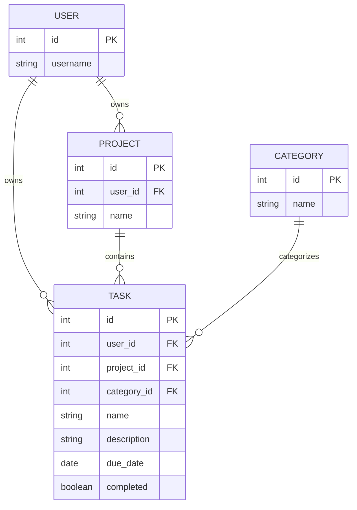

# Task Tracker ERD

This ERD shows the current database structure for the Task Tracker
application.

## Relationships

### User to Project

One user can own many projects.

A project belongs to one user.

### User to Task

One user can own many tasks.

A task belongs to one user.

The username is stored in the Task Tracker database so tasks can be
associated with the authenticated user.

### Project to Task

One project can contain many tasks.

A task belongs to one project.

### Category to Task

One category can be assigned to many tasks.

A task belongs to one category.

Deleting a user deletes their projects and tasks. Deleting a project
deletes its tasks. Deleting a task does not delete its project or user.

These relationships provide the multiple one-to-many relationships
required for the individual project.