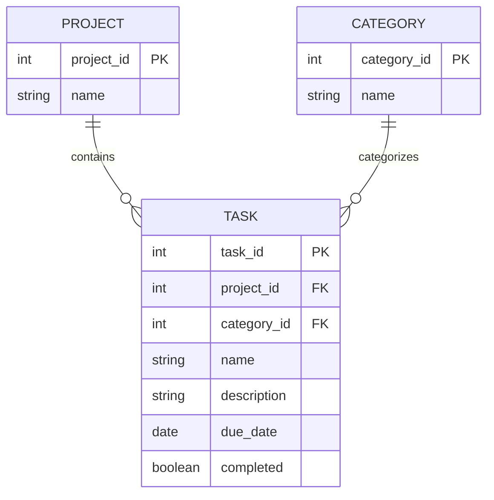

# Task Tracker ERD

This ERD shows the planned database structure for the Task Tracker
application.

## Relationships

### Project to Task

One project can contain many tasks.

A task belongs to one project.

### Category to Task

One category can be assigned to many tasks.

A task belongs to one category.

These relationships provide the multiple one-to-many relationships
required for the individual project.